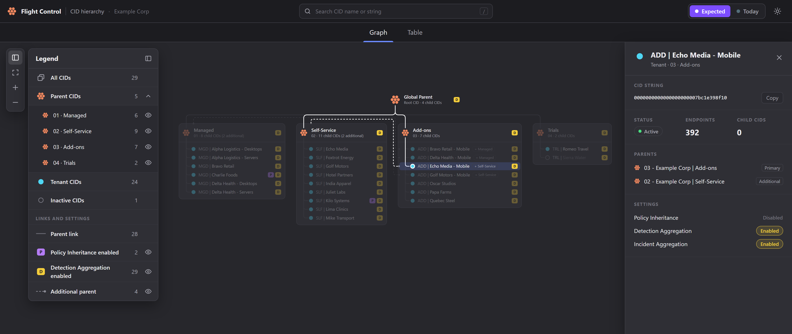

# CrowdStrike AI Flight Control

> An AI-driven review toolkit for the CrowdStrike Falcon **Flight Control CID hierarchy**: it draws your current parent/child structure from a console export, applies the corrections you describe in plain language, and writes the step-by-step **ticket for CrowdStrike support**, with no hand-built CSVs and no names checked one by one.

<p align="center">
  
</p>

<table width="100%">
<thead>
<tr><th align="left">Before<div></div></th><th align="left">Now<div></div></th><th align="left">What it buys<div></div></th></tr>
</thead>
<tbody>
<tr><td>a manual review: export the CIDs, validate every name by hand, write another CSV and the support ticket by hand</td><td>an AI runs the review quickly and methodically, checking every CID and every rule, without the errors that slip through a manual pass</td><td>time saved: the drawing of the current structure and the support ticket text are generated automatically</td></tr>
</tbody>
</table>

---

## Overview

CrowdStrike Falcon **Flight Control** organizes an MSSP's tenants as parent and child CIDs. Changing that hierarchy (renaming CIDs, moving them between parents, adding a second parent, switching Policy Inheritance or Detection Aggregation, creating or deleting CIDs) is usually done by **CrowdStrike support, from a ticket**. Preparing that ticket by hand is slow and error-prone: a name that changed halfway through, a forgotten CID, a step in the wrong order, a setting that should have changed together with another.

This toolkit turns that review into a loop driven by **Claude Code**: a skill ([`Review.md`](Review.md)) reads the export, draws the hierarchy, takes your corrections in plain language and keeps the expected structure; a generator compares it with the export and writes both an **interactive page** (graph and table, Expected vs Today) and the **ticket text**, every CID identified by its CID String.

## How It Works

- **Stage 1. Export.** You export the CID list from the Falcon console into `Input/CIDs.csv`. The skill checks it is current and draws today's structure.
- **Stage 2. Correct.** You describe the changes in your own words. The AI maps each one to specific CIDs (asking when a name could match more than one), repeats back what it understood, enforces your rules, and records the change in the day's expected structure (`CIDs_Expected.csv`).
- **Stage 3. Ticket.** The generator writes the day's page and the ticket text: only what changes, in a safe order (create, rename, change parents, change settings, delete), with the expected result at the end so support can check its work.
- **Stage 4. Verify.** When support replies, a fresh export is compared against the same expected structure, showing what was applied and what is still pending.

> 📅 **Every review day gets its own folder**, `Output/YYYY-MM-DD/`. Running again on the same day updates it; earlier days are never touched and stay as the history of each review.

---

<details>
<summary><strong>Requirements</strong> (click to expand)</summary>

- **CrowdStrike Falcon** with **Flight Control** (parent/child CIDs), and access to export the CID list from the console
- **Claude Code**, to run the AI review
- **Python 3** (standard library only, tested with 3.11)
- A web browser to open the generated page: it is self-contained, so it also opens offline

</details>

<details>
<summary><strong>Setup</strong> (click to expand)</summary>

### 1. No dependencies

The generator uses only the Python standard library: there is no virtual environment or `requirements.txt` to install.

### 2. CID export

Export the CID list from the Falcon console and save it as `Input/CIDs.csv`. To try the toolkit first, copy the fictional `Input/CIDs_example.csv` to `Input/CIDs.csv` instead (see *Try it with the example* under **Usage**). The generator expects the console's CSV header:

```
CID Name,CID String,Customer ID Checksum (CCID),Status,Is Parent?,Parent,Additional Parent,CID Groups,Number of Endpoints,Number of Endpoints Seen Last 45 Days,Number of Child CIDs,Number of Total Endpoints,Number of Total Endpoints Seen Last 45 Days,Policy Inheritance,Detection Aggregation,Incident Aggregation,Domain Allowlist,Falcon Module Subscriptions,Application and Plugin Integrations
```

### 3. Your rules

Two rules are set at the top of `Scripts/Generate-FlightControl.py` (`Part 1: Setup`). Adjust them to your organization's conventions:

<table width="100%">
<thead>
<tr><th align="left">Constant<div></div></th><th align="left">Purpose<div></div></th></tr>
</thead>
<tbody>
<tr><td><code>MAX_NAME</code></td><td>Longest CID name allowed for a new or renamed CID (default <code>38</code>; <code>0</code> turns the check off). The AI suggests shorter names when a request goes over it.</td></tr>
<tr><td><code>INCIDENT_FOLLOWS_DETECTION</code></td><td>When <code>True</code> (default), Incident Aggregation must always match Detection Aggregation: the AI changes both together, and the ticket states the rule.</td></tr>
</tbody>
</table>

> ⚠️ **Never commit your data.** The export and everything generated from it carry your CID Strings and customer names. Keep `Input/CIDs.csv` and the day folders in `Output/` out of the repository; only the fictional examples belong there.

</details>

<details>
<summary><strong>Usage</strong> (click to expand)</summary>

### Try it with the example

The repository ships a finished review of a fictional company, *Example Corp*: open `Output/Example/CIDs.html` to explore the page, and read `Output/Example/Case_Message.txt` for the ticket it produced. To run it yourself:

```bash
cp Input/CIDs_example.csv Input/CIDs.csv
mkdir -p Output/$(date +%F)
cp Output/Example/CIDs_Expected.csv Output/$(date +%F)/
python Scripts/Generate-FlightControl.py
```
→ today's folder gets the same page and the same `Case_Message.txt` as `Output/Example/`

### With Claude Code *(recommended)*

1. Export the CID list and save it as `Input/CIDs.csv`.
2. Open Claude Code at the repository root. `CLAUDE.md` points the session to [`Review.md`](Review.md): it checks the export is current and draws the structure in `Output/<YYYY-MM-DD>/CIDs.html`.
3. Open the page and describe the corrections in your own words, for example *"rename line 01 to Managed"* or *"add-on tenants of existing clients also go under their main service line"*. The AI repeats what it understood, applies it to the expected structure, and regenerates the page and the ticket.
4. Repeat until the **Expected** view looks right, then copy the day's `Case_Message.txt` into your CrowdStrike support ticket.
5. When support replies, export again and open a new session: the AI picks up the latest expected structure and shows what was applied and what is still pending.

### Running the generator directly

```bash
python Scripts/Generate-FlightControl.py
```
→ `Output/<YYYY-MM-DD>/CIDs.html`, plus `Case_Message.txt` when the day has an expected structure

```bash
python Scripts/Generate-FlightControl.py --init-expected
```
→ `Output/<YYYY-MM-DD>/CIDs_Expected.csv`, a copy of the export to start correcting from

```bash
python Scripts/Generate-FlightControl.py --keep-expected
```
→ copies the latest `CIDs_Expected.csv` of an earlier day into today's folder, to go on from where that review stopped

> 🔧 The generator never needs editing for a correction: every change goes into `CIDs_Expected.csv`. Its output says what was written (`OK`), what deserves attention (`WARNING`) and what stops the run (`ERROR`), such as an unexpected export header, a duplicate CID or a broken rule.

</details>

<details>
<summary><strong>Page and Ticket</strong> (click to expand)</summary>

The day's `CIDs.html` is a single self-contained page, laid out like the CID overview of the Falcon console (dark by default, with a light theme). It needs no library and no internet connection:

<table width="100%">
<thead>
<tr><th align="left">Element<div></div></th><th align="left">What it shows<div></div></th></tr>
</thead>
<tbody>
<tr><td>Views</td><td><strong>Expected</strong> (after the changes) and <strong>Today</strong> (the export), switched in the header of the same page</td></tr>
<tr><td>Graph</td><td>The root CID on top and one card per service line (its direct children) below it, with the line's tenants in rows; a tenant with an additional parent gets a <code>+ &lt;parent&gt;</code> chip and a dashed link to it</td></tr>
<tr><td>Marks</td><td>As in the Falcon legend: parent CIDs in orange, tenants in cyan, inactive CIDs hollow and gray; a <strong>P</strong> badge for Policy Inheritance and a <strong>D</strong> badge for Detection Aggregation, with purple links where Policy Inheritance is enabled</td></tr>
<tr><td>Legend</td><td>Counts of what is shown; each service line can be hidden or shown alone, and the badges and additional parents can be switched off</td></tr>
<tr><td>Details</td><td>Clicking a CID lights up its whole chain (parents up to the root, children down) and opens a drawer with its CID String (with a copy button), status, endpoints, parents, settings and children</td></tr>
<tr><td>Table</td><td>The same CIDs as a sortable table, with the same filters and a copy button for every CID String</td></tr>
<tr><td>Search</td><td>By CID name or CID String (<code>/</code> focuses it), in both the graph and the table</td></tr>
</tbody>
</table>

The day's `Case_Message.txt` is the ticket, in English:

<table width="100%">
<thead>
<tr><th align="left">Section<div></div></th><th align="left">Content<div></div></th></tr>
</thead>
<tbody>
<tr><td>General notes</td><td>Identify CIDs by CID String, do the steps in order, change nothing that is not listed</td></tr>
<tr><td>Steps</td><td>Only the steps that have content, in order: create CIDs, rename CIDs, change parent links, change settings, delete CIDs</td></tr>
<tr><td>Inactive CIDs</td><td>For each inactive CID in the steps, a request to skip it if the console refuses and report it</td></tr>
<tr><td>Expected result</td><td>Total CIDs, child count of every parent (additional-parent links included), additional parents and the final state of each setting</td></tr>
</tbody>
</table>

</details>

<details>
<summary><strong>File Structure</strong> (click to expand)</summary>

```
CS-AI-Flight-Control/
├── Review.md                          # The Claude Code skill that runs the review
├── CLAUDE.md                          # Points every Claude Code session to Review.md
├── LICENCE.md                         # The MIT License
├── Scripts/
│   └── Generate-FlightControl.py      # Compares export and expected structure; writes page and ticket
├── Input/
│   ├── CIDs.csv                       # Your CID export from the Falcon console (do not commit)
│   └── CIDs_example.csv               # Example: a fictional export
├── Output/
│   ├── Example/                       # Example: a finished review of the fictional export
│   │   ├── CIDs_Expected.csv
│   │   ├── CIDs.html
│   │   └── Case_Message.txt
│   └── <YYYY-MM-DD>/                  # One folder per review day (do not commit)
│       ├── CIDs_Expected.csv          # The expected structure: the source of every correction
│       ├── CIDs.html                  # The generated page (graph and table)
│       └── Case_Message.txt           # The generated support ticket
└── Files/
    └── flight-control-graph's.png       # Example: the generated page (fictional data)
```

</details>

<details>
<summary><strong>Roadmap / Next Steps</strong> (click to expand)</summary>

- **Read the CID list straight from the Falcon API**, instead of a manual console export.

</details>

---

## License

This toolkit is released under the MIT License: use, adapt and redistribute it freely. Full terms in [LICENCE.md](LICENCE.md).
